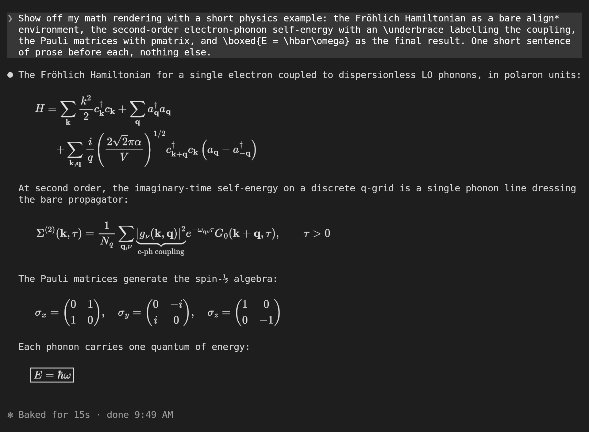
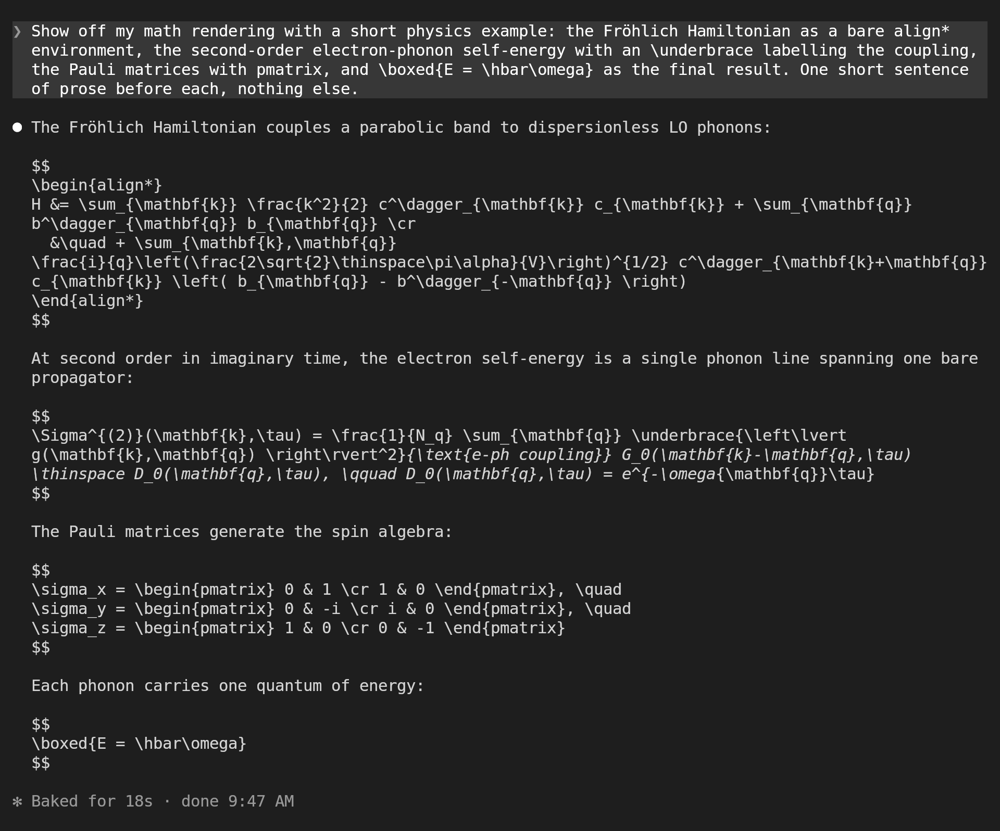

# claude-code-latex

A [Claude Code](https://claude.com/claude-code) mod that renders LaTeX display math in the **terminal**. Claude's `$$…$$` blocks show up as typeset equations instead of raw source.

<p align="center"></p>

- **Nothing to install.** MathJax 3 is bundled, and the SVG it produces is turned into pixels by a small pure-TypeScript rasterizer and PNG encoder. There's no TeX install, no WebAssembly and no network access.
- **No more eaten backslashes.** The math is cut out of the reply's raw text before Claude Code's Markdown renderer sees it, so `\,`, `\{`, `\\` and friends reach TeX intact.
- **Covers what you use:** `$$…$$`, `\[…\]`, bare `equation`, `align`, `gather` and `multline` environments (starred too), AMS packages, `mhchem`, matrices, stretchy braces and arrows, `\boxed`, `\cancel` and `\enclose`.
- **Tells Claude about it.** Once per context window, Claude gets a short note that display math is drawn here and that inline math isn't, so it writes formulas as display blocks instead of in code fences.

<details>
<summary>The same prompt without the mod</summary>
<p align="center"></p>
</details>

## Requirements

- **Claude Code 2.1.287 or later.** Mods were introduced in this version, and they're early access: if your build has them switched off, nothing loads.
- **For images, a terminal with the kitty graphics protocol:** [kitty](https://sw.kovidgoyal.net/kitty/) or [Ghostty](https://ghostty.org/). Everywhere else, including inside tmux, display math is written as Unicode text instead (`Σ⁽²⁾(k, τ) = 1/N_q ∑_(q,ν) …`). The terminal is detected from `TERM`, `TERM_PROGRAM`, `KITTY_WINDOW_ID` and `TMUX`.

## Install

From the marketplace:

```sh
claude plugin marketplace add samox73/claude-code-latex
claude plugin install tex-display@claude-code-latex
```

Or from a clone, so edits apply on the next start:

```sh
git clone https://github.com/samox73/claude-code-latex
claude --plugin-dir ./claude-code-latex
```

To always load the clone, add it to `~/.claude/settings.json` (or to `settings.json` in `$CLAUDE_CONFIG_DIR`):

```json
{ "env": { "CLAUDE_CODE_PLUGIN_DIRS": "/absolute/path/to/claude-code-latex" } }
```

## Settings

Both appear in `/config`, or can be set under `pluginConfigs.tex-display.options` in your settings.

| Setting | Default | What it does |
| --- | --- | --- |
| `cellAspect` | `2.15` | Your terminal cell's height ÷ width in pixels. A mod can't measure this. The terminal keeps a picture's proportions, so when the value is off, math is never distorted: it's just drawn slightly smaller than its cells, with a gap beside or below it. Most monospace fonts are 2.0–2.3. Set it with `/tex-calibrate`. |
| `scale` | `1` | How tall one TeX em is drawn, in terminal rows. The terminal font itself is about 0.8. |

**`/tex-calibrate`** opens a pane with a light box drawn for a trial `cellAspect`, on a blue background exactly its size in cells. Press <kbd>v</kbd> while blue shows above or below the box, or <kbd>h</kbd> while it shows at the sides, until no blue is left. Then press <kbd>s</kbd> to save it as your setting. <kbd>Esc</kbd> closes the pane without saving.

The ink is light grey under dark themes and near-black under light ones. Under the `auto` theme, the mod reads the terminal's `COLORFGBG` if it sets one (Konsole and rxvt do, kitty doesn't); otherwise it assumes dark.

## How it works

The mod hooks the drawing of each assistant message (`ui.render` on `AssistantMessage`). When the text contains display math, it splits it:
- prose and code fences go back to Claude Code's own Markdown renderer;
- each display block is converted by MathJax to SVG paths, filled into an anti-aliased mask by `hooks/raster.ts`, packed into a 4-bit palette PNG by `hooks/png.ts`, and drawn with the `Image` element.

An image covers whole terminal cells, so it's sized to a whole number of rows and centred in them. Results are cached per equation.

Everything the mod hooks, and why (`claude plugin validate .claude-plugin/plugin.json` lists the same):

| Hook or call | Purpose |
| --- | --- |
| `ui.render` (`AssistantMessage`) | Draw replies containing display math as Markdown plus images |
| `prompt.submit` | Attach the math note to the first prompt of each context window |
| `session.compact`, `session.end` | Notice a compaction or `/clear`, so the note is sent again |
| `config.set` (`theme`), `$.config.list` | Pick the ink colour from the theme |
| `session.start`, `command.run`, `ui.render` (`Pane`), `$.command.register`, `$.ui.open`, `$.ui.close`, `$.ui.toast` | The `/tex-calibrate` command and its pane |
| `$.state.get`, `$.state.set` | The calibration pane's trial value (`tex-display.aspect`) |
| `$.config.set` | Save the calibrated `cellAspect` when you press Save |
| `$.env.get` | Detect the terminal (`TERM`, `TERM_PROGRAM`, `KITTY_WINDOW_ID`, `TMUX`) and its background (`COLORFGBG`) |
| `$.session.surfaces` | Only send the note when a terminal is drawing the session |
| `$.ui.resolve` | Get the terminal's element constructors (`Box`, `Markdown`, `Image`) |

The math note is about 110 tokens. It's attached to a prompt rather than the system prompt because Claude Code's built-in security plugin bypasses `prompt.compose` and `prompt.context` for user-installed mods.

## Limits

- **No inline math.** An image takes up whole cells and can't sit inside a line of text, so `$…$` stays as text. The note asks Claude not to write it.
- **One colour.** `\color` is ignored and everything is drawn in the theme's ink.
- **Size per message.** Claude Code accepts at most 2 MiB of image data per drawn message. A large equation is about 20 KB as PNG, so this rarely matters. Equations past the limit show as `latex` code blocks.
- **Errors.** A TeX error shows the source as a `latex` code block.
- **While streaming,** an unfinished `$$` block shows as text until its closing delimiter arrives.

## Compared with other LaTeX mods

Four LaTeX mods were listed on [mods.aidojo.si](https://mods.aidojo.si) in October 2026. This comparison comes from reading each one's README and hook source at that time.

| | claude-code-latex (this) | [figures](https://github.com/natsukium/claude-code-figures-plugin) | [latex-render](https://github.com/chang-07/cc-latex) | [latex-inline](https://github.com/dazebug/latex-inline) | [latex](https://github.com/zaahiral/claude-latex) |
| --- | --- | --- | --- | --- | --- |
| Draws in | terminal (kitty, Ghostty) | terminal (kitty, Ghostty) | terminal (macOS) | terminal (Ghostty, kitty) | desktop app's Code tab |
| Renderer | MathJax 3 + its own rasterizer, in the mod | MathJax 4 in the mod + the `resvg` binary | `tectonic` + `pdftocairo` + `sips` | MathJax 4 + resvg-js in a `node` process | MathJax 3 in the mod (vector `Svg`) |
| You install | nothing | `resvg` | tectonic, poppler (Homebrew) | Node.js ≥ 18 | nothing for math; TeX for diagrams |
| Inline math | no | no | no | yes | yes |
| Other terminals | Unicode text | TeX source (it stays above the images anyway) | tmux via its bridge script | Unicode text | — |
| Bare `align` etc. | yes | no | no | no | yes |
| Math replaces the source | yes | no: pictures go under the reply | yes | yes | yes |
| Tells Claude | first prompt per context window | an optional skill | `prompt.compose` | `prompt.compose` | `prompt.compose` |
| Runs processes / writes files | no / no | yes / yes | yes / yes | yes / yes | yes / yes |
| Extras | — | Mermaid, Graphviz, D2, tool-result images, a gallery pane | tmux passthrough | font metrics read from your terminal config | TikZ, LaTeX blocks, 10 fonts, macros |

**Pick this one** if you want display math in the terminal with no dependencies and the smallest footprint: it runs no processes, writes no files, reads no transcript and keeps no state. It's also the only one that renders bare `align`/`gather` environments in the terminal, and that keeps each reply within Claude Code's 2 MiB image limit.

**Pick another** if you need what this one deliberately leaves out:
- inline math: latex-inline;
- diagrams and images from tool results: figures;
- the desktop app: latex.

**A note on telling Claude.** In our testing, Claude Code's built-in security plugin skipped `prompt.compose` for mods you install yourself. Mods that rely on it may find Claude never sees their note, so it keeps writing math in code fences. This mod attaches its note to a prompt instead, which isn't skipped.

## Develop

```sh
npm install          # esbuild + mathjax-full, only needed to rebuild the bundle
npm run build        # rebuild hooks/mathjax/ from mathjax-full
claude plugin test . # tests run in the mod sandbox
node build/preview.ts '\frac{a}{b}' out.png 60   # render one equation to a PNG
nix shell nixpkgs#sway -c nu build/screenshots.nu  # retake the README screenshots
```

`build/screenshots.nu` runs a real `claude` in a real kitty on a headless sway, types the prompt through kitty's remote control, and captures the reply with `grim`. It uses your Claude Code login and sends one prompt per screenshot.

The MathJax bundle in `hooks/mathjax/` is split into chunks because Claude Code won't load a module file over 1 MiB. `npm run build` regenerates it reproducibly from `mathjax-full` 3.2.2.

## License

MIT. The bundled MathJax is Apache 2.0, with its license in `hooks/mathjax/LICENSE`. The Unicode fallback is [latex-inline](https://github.com/dazebug/latex-inline)'s `texToUnicode`, vendored unchanged under its MIT license in `hooks/vendor/latex-inline/`.
